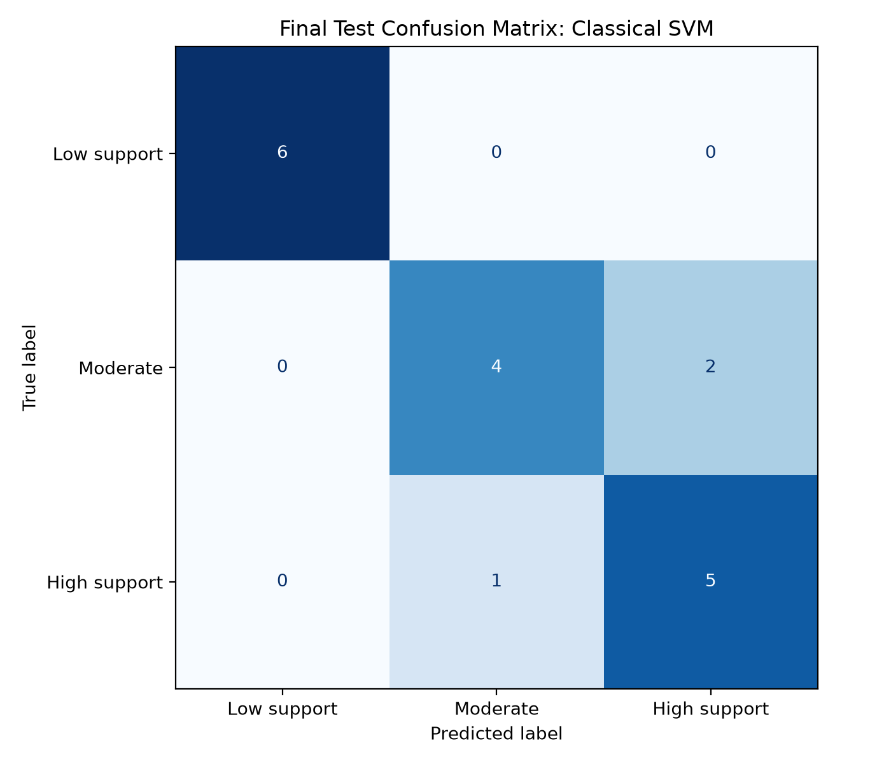

# Quantum Machine Learning for Personalised Student Learning

## Overview

This project explores Quantum Machine Learning (QML) for classifying students into academic performance-based support categories.

It compares three quantum kernel-based Support Vector Classifiers (QSVCs), using different quantum feature maps, against a classical Support Vector Machine (SVM).

The objective is to investigate whether quantum feature representations offer useful classification performance on a small student performance dataset.

## Objectives

- Explore quantum feature maps for machine learning.
- Implement quantum kernel-based classification using Qiskit.
- Compare quantum models with a classical SVM baseline.
- Evaluate model performance using validation and independent test sets.

## Dataset

The project uses the [UCI Student Performance Dataset](https://archive.ics.uci.edu/dataset/320/student+performance), specifically the Mathematics (`student-mat.csv`) dataset.

The original dataset contains 395 student records and 33 attributes.

Four input features were selected:

| Feature | Description |
|---|---|
| `absences` | Number of school absences |
| `studytime` | Weekly study time category |
| `G1` | First-period grade |
| `G2` | Second-period grade |

The final grade (`G3`) is used only to construct the target labels. It is not provided as a model input.

### Target Classes

| Class | Support Category | Condition |
|---|---|---|
| 0 | Low support | G3 ≥ 15 |
| 1 | Moderate support | 10 ≤ G3 < 15 |
| 2 | High support | G3 < 10 |

These categories are proxies derived from final academic performance, not directly observed student support requirements.

A balanced subset of 90 records was created, with 30 records per class. This smaller dataset was used to keep quantum kernel simulation computationally manageable.

## Methodology

1. Load and preprocess the dataset.
2. Select four input features and construct target labels from G3.
3. Create a balanced subset of 90 records.
4. Perform a stratified 60:20:20 train-validation-test split:
   - Training: 54 records
   - Validation: 18 records
   - Testing: 18 records
5. Fit preprocessing transformations using training data.
6. Train and compare candidate models using validation macro F1-score.
7. Select the best model based on validation performance.
8. Evaluate all candidate models on the held-out test set.

For final testing, the candidate models are retrained using the combined training and validation sets. The scaler is refitted on this combined dataset before transforming the training and test data.

## Quantum Machine Learning Approach

A quantum feature map transforms classical input data into quantum states.

For an input vector $x$, the feature map prepares a quantum state $|\phi(x)\rangle$. The quantum kernel measures the squared overlap between two such states:

$$
K(x,x') = |\langle\phi(x)|\phi(x')\rangle|^2
$$

These kernel values are used by a Support Vector Classifier to perform classification.

### Quantum Circuit Configuration

- Number of qubits: 4 (one per selected feature)
- Repetitions: 2
- Simulator: Qiskit Aer
- Shots: 512
- Random seed: 42

Three feature maps were evaluated:

| Feature Map | Configuration |
|---|---|
| ZFeatureMap | 4 features, 2 repetitions |
| ZZFeatureMap | 4 features, 2 repetitions, linear entanglement |
| PauliFeatureMap | Pauli operators: Z, ZZ, XX; 2 repetitions |

The quantum kernel was implemented using `FidelityQuantumKernel` and `ComputeUncompute`.

The quantum circuits were executed using a classical simulator, not physical quantum hardware.

## Classical Baseline

A classical Support Vector Machine with an RBF kernel was used as the baseline.

$$
K(x,x') = e^{-\gamma\|x-x'\|^2}
$$

This provides a comparison between quantum fidelity-based kernels and a conventional nonlinear kernel.

## Results

### Validation and Test Performance

Macro F1-score was used as the primary model-selection metric.

| Model | Validation Macro F1 | Test Macro F1 |
|---|---:|---:|
| ZFeatureMap QSVC | 0.8322 | 0.8857 |
| ZZFeatureMap QSVC | 0.7304 | 0.6084 |
| PauliFeatureMap QSVC | 0.5519 | 0.6256 |
| Classical RBF-SVM | **0.8889** | 0.8322 |

The Classical RBF-SVM was selected based on its highest validation macro F1-score.

### Final Confusion Matrix



Additional performance comparisons, confusion matrices and circuit visualisations are available in the `results/` directory.

## Findings

The classical RBF-SVM achieved the highest validation macro F1-score (0.8889), while the ZFeatureMap QSVC achieved the highest test macro F1-score (0.8857).

Model selection was based on validation performance rather than test performance. The results show that the classical baseline performed best during model selection on this dataset. They do not establish quantum advantage.

Interestingly, the ZFeatureMap QSVC performed better on the test set than the two feature maps incorporating entangling operations (ZZ and Pauli). This suggests that increased circuit complexity or entanglement does not automatically improve classification performance, particularly with a small dataset and limited training samples.

## Limitations

- The experiment uses only 90 records from the original dataset.
- The test set contains 18 records, making performance estimates sensitive to individual predictions. One test prediction changes accuracy by approximately 5.56 percentage points.
- Only one train-validation-test split has been evaluated so far. Repeated splits are needed to assess result stability.
- G1 and G2 are strongly related to G3, which may make the classification task easier. An ablation study excluding these features would help assess their influence.
- The target categories are derived from final grades and do not represent independently measured student support needs.
- Quantum models were evaluated using classical simulation rather than actual quantum hardware.
- No quantum advantage is claimed.

## Technologies Used

- Python 3.13.3
- Qiskit 2.6.2
- Qiskit Aer
- Qiskit Machine Learning
- Scikit-learn
- Pandas
- NumPy
- Matplotlib
- Streamlit

## Reproducibility

The experiments use random seed `42` for reproducibility.

Install dependencies:

```bash
pip install -r requirements.txt
```

Run the experiment:

```bash
python main.py
```

Launch the Streamlit application:

```bash
streamlit run app.py
```

## Future Work

- Evaluate model stability across multiple random splits and report mean and standard deviation.
- Conduct feature ablation experiments, particularly excluding G1 and G2.
- Explore larger datasets and additional feature maps.
- Investigate execution on actual quantum hardware.
- Improve the interactive Streamlit application.

## References

### Dataset

1. Cortez, P., & Silva, A. (2008). Using data mining to predict secondary school student performance. In *Proceedings of the 5th Future Business Technology Conference (FUBUTEC 2008)*, pp. 5–12. Porto, Portugal: EUROSIS.

2. Cortez, P. (2008). *Student Performance* [Dataset]. UCI Machine Learning Repository. https://doi.org/10.24432/C5TG7T

### Quantum Machine Learning

3. Havlíček, V., Córcoles, A. D., Temme, K., Harrow, A. W., Kandala, A., Chow, J. M., & Gambetta, J. M. (2019). Supervised learning with quantum-enhanced feature spaces. *Nature, 567*, 209–212. https://doi.org/10.1038/s41586-019-0980-2

4. Schuld, M., & Killoran, N. (2019). Quantum machine learning in feature Hilbert spaces. *Physical Review Letters, 122*(4), 040504. https://doi.org/10.1103/PhysRevLett.122.040504

### Framework and Implementation

5. Qiskit Machine Learning Documentation. *Quantum Kernel Machine Learning*. https://qiskit-community.github.io/qiskit-machine-learning/tutorials/03_quantum_kernel.html

6. Qiskit Machine Learning Documentation. *FidelityQuantumKernel API Reference*. https://qiskit-community.github.io/qiskit-machine-learning/stubs/qiskit_machine_learning.kernels.FidelityQuantumKernel.html

7. Scikit-learn Documentation. *Support Vector Classification (SVC)*. https://scikit-learn.org/stable/modules/generated/sklearn.svm.SVC.html
